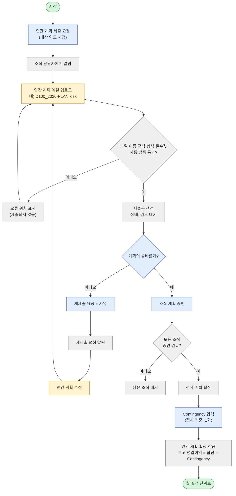
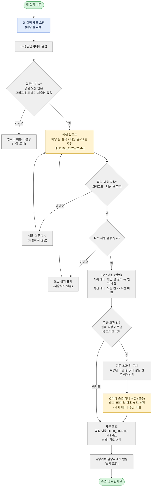
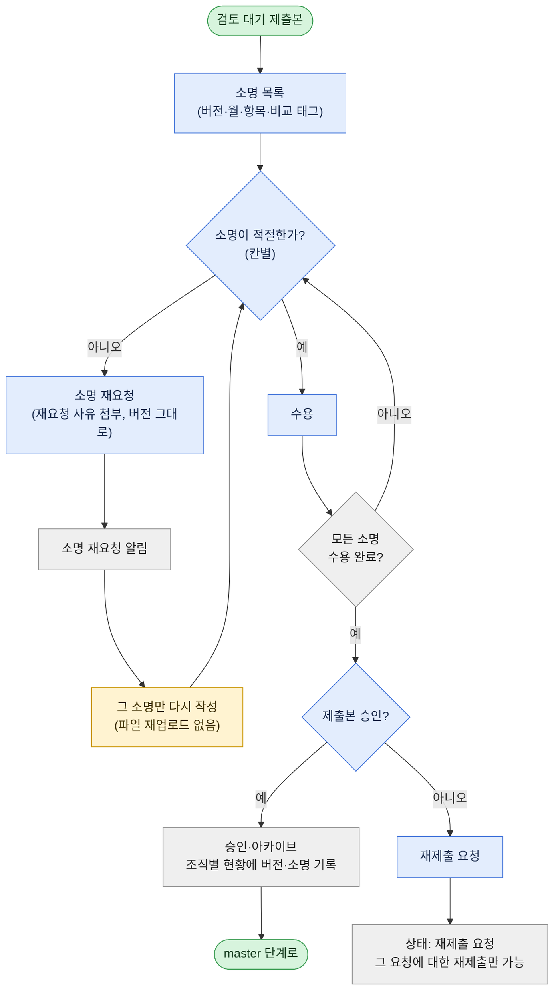
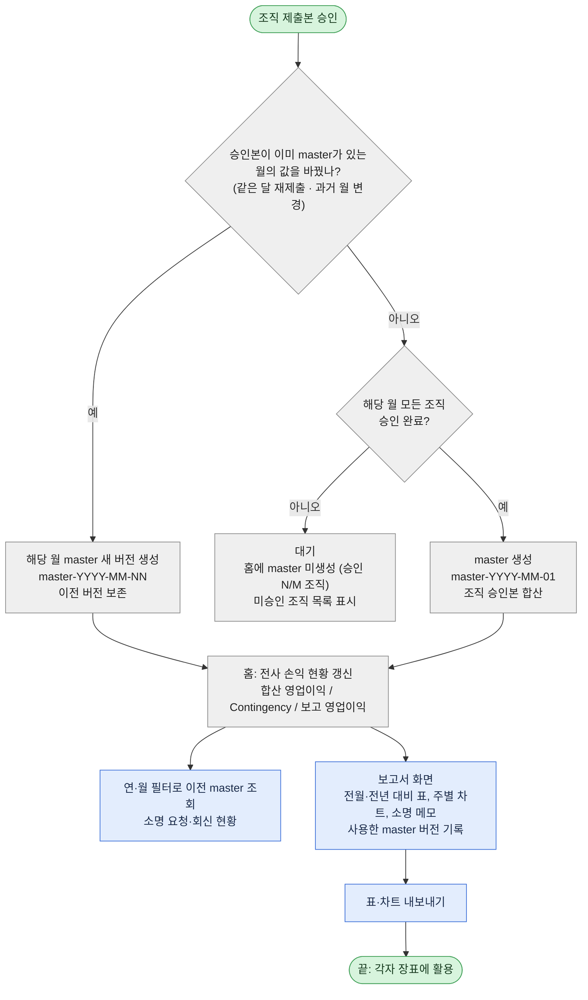
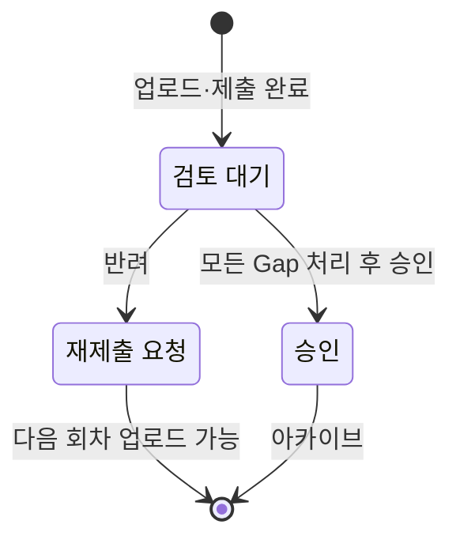
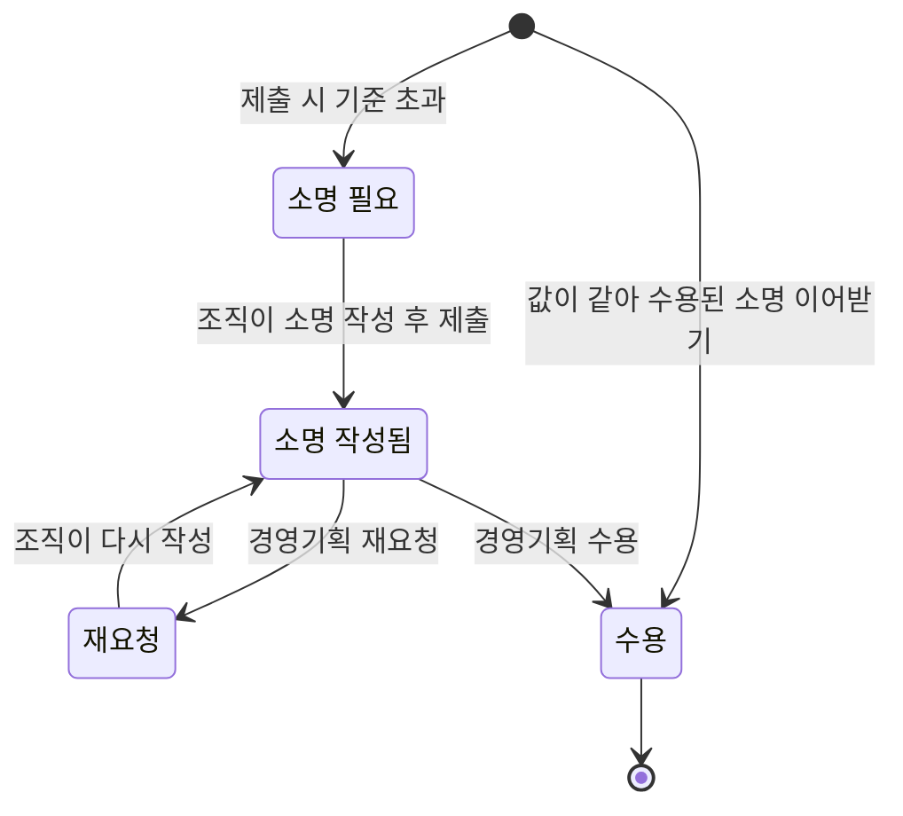

# 업무 흐름도

[도메인 규칙](domain-rules.md)을 단계별 흐름으로 나타낸 문서입니다.

**색 구분**

| 색 | 주체 |
| --- | --- |
| 파랑 | 경영기획 담당자 |
| 노랑 | 조직 담당자 |
| 회색 | 시스템 (자동 처리) |

## 전체 단계

## 1. 연간 계획 수립

## 2. 월 실적 제출

## 3. 소명 검토·승인

### Gap 기준 설정 (경영기획 담당자, 수시)

## 4. master·대시보드·보고

## 상태

### 제출본

### Gap 항목 (소명)

